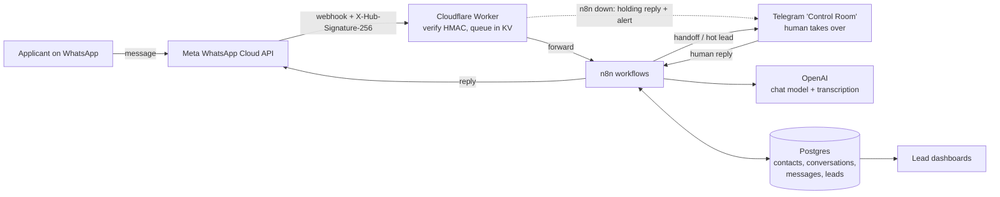

# Alice — a WhatsApp AI agent for driver recruitment (case study)

Alice is a WhatsApp AI agent that answers and qualifies driver applicants
for a ride-hailing fleet in Europe, which I co-own. People click an ad,
land in WhatsApp, and Alice talks to them: answers questions, finds out
whether they can start driving, and hands the ready ones to a human.

I designed, built and operate it. I am based in Ireland. My partner in the
fleet approved publishing this case study.

> **What this repository is:** a sanitized case study. The code here is
> either rewritten for publication (the edge Worker, the schema, the
> anonymiser) or a small excerpt with fake data (`workflow/`).
> **The production n8n workflows and the production prompt are not
> published.** No real phone numbers, names, keys, hosts or identifiers
> appear anywhere in this repository.

## Contents

| Path | What |
|---|---|
| [`SECURITY-REVIEW.md`](SECURITY-REVIEW.md) | What I found in my own system and how it was fixed (verified items only). |
| [`worker/`](worker/) | Cloudflare Worker in front of n8n: verifies Meta's signature (constant-time), queues messages if n8n is down. With offline tests. |
| [`database/schema.sql`](database/schema.sql) | Postgres schema: contacts, conversations, messages, leads, debounce buffer, idempotency. |
| [`tools/`](tools/) | `anonymise.py`: strips phones and e-mails from conversations before they become test material. With tests. |
| [`workflow/`](workflow/) | Small excerpts that illustrate decisions (debounce, single message, XSS fix). |

## The problem

The fleet advertises for drivers on Meta (click-to-WhatsApp ads). Every
click opens a WhatsApp conversation, at any hour, often in the applicant's
own language, and most of them start with the ad's pre-filled text rather
than a real question. Before Alice, someone had to answer each one by hand,
ask the same qualifying questions, and figure out who could actually start.

What the agent needs to do:

- answer within seconds, in the applicant's language;
- find out, without an interrogation, whether the person holds a driving
  licence and the local permit required to drive for platforms;
- never invent pay figures, conditions or vehicle availability;
- hand the conversation to a human at the right moment, and then **stay
  quiet**;
- keep personal data to the minimum the triage needs.

## Architecture



ASCII version:

```
Applicant ──> Meta WhatsApp Cloud API ──webhook──> Cloudflare Worker ──> n8n ──> OpenAI
                      ^                            (HMAC check,           │ ^
                      │                             KV queue,             v │
                      │                             failover)          Postgres ──> dashboards
                      └──────────── reply ─────────────────────────────── n8n
                                                                           │
                                         Telegram "Control Room" <─────────┘  (handoff, alerts,
                                         (humans take over)                     human replies)
```

**Why each piece:**

- **Edge Worker.** Meta disables a webhook that keeps failing. The Worker
  always answers Meta quickly, verifies the signature before anything
  touches n8n, and if n8n is down it sends the applicant a holding reply,
  alerts a human and queues the message for replay.
- **n8n.** The conversation logic is a visual workflow (around 50 nodes)
  that a non-developer partner can follow. Code lives in small Code nodes
  where logic is easier to read as code.
- **Postgres.** Conversation state (who owns the conversation: AI or
  human), structured lead fields and chat memory.
- **Telegram Control Room.** The humans already live in chat apps. Handoffs,
  hot-lead alerts and human replies happen there.

## Conversation design

**The opening gives before it asks.** The first reply introduces Alice,
states the concrete offer (vehicle rental price from a fixed weekly
amount, subject to availability) and only then offers three paths:
*licence + permit*, *licence only*, *no licence yet*. Applicants can
answer with a number or just write.

**The menu is shown once.** If the person ignores it and asks something,
Alice answers *their* question. Repeating "please reply 1, 2 or 3" was the
fastest way to lose people.

**Structured output, not free text.** Every model turn returns:

```json
{ "action": "reply | handoff | ignore", "message": "...",
  "lead_update": { "has_licence": true, "...": "..." },
  "language": "en", "confidence": 0.8, "handoff_reason": "..." }
```

The workflow routes on `action`. The model never sends anything itself.

**Hard limits in the prompt:** never invent earnings, conditions or
vehicle availability ("I'd rather confirm that with a colleague than
guess"); never ask for ID numbers, bank details, address or document
photos; never promise a job; never claim to be a person if asked directly.

**Handoff triggers:** applicant is ready (licence + permit), wants a call
or a visit, asks something only a human can answer, is upset or suspicious,
mentions something sensitive, or the conversation is going nowhere after
8–10 messages.

**Mechanics that make it feel human:** a ~7-second debounce so three quick
messages get one answer; a "typing" indicator; voice notes transcribed and
treated as text; deterministic language detection (word lists, no AI) that
needs more evidence to switch away from the default language than to stay.

## Key decisions, and why

**1. One WhatsApp message per turn.** The model thinks in parts (separated
by `|||`); the send step joins them into a single message. Outbound
WhatsApp messages are priced per message, so the rule is "fewer messages,
never more" — a node that split replies into separate bubbles is
disconnected on purpose. If a reply feels like a wall of text, the fix is
to write less. (Which messages are billable depends on Meta's pricing
category and the customer-service window; check current pricing before
copying this rule.) See [`workflow/single-message.js`](workflow/single-message.js).

**2. Prompt size is decided by quality, not by token cost.** I estimated
it (token count × list price): the corrected version's system prompt was about 5,800 tokens, and the AI costs roughly
**€0.011 per lead** against **about €4.50 per lead** for the ad — about **0.24%**
of acquisition cost. My first instinct when the prompt grew was to shorten
it to save money. That would have been optimising the wrong side.

**3. Humans stay in charge.** A handoff sets `ai_paused`; from then on
Alice only stores messages and pings the human. Hot leads trigger one
alert, once. The humans reply from Telegram through the Control Room.

**4. Test conversations are anonymised first.** Real conversations are the
best test material and they are full of personal data. `anonymise.py`
replaces phones and e-mails with stable codes, writes no reversal map by
default, and prints a review report to the terminal only. Its limitations
are written down in its README. See [`tools/`](tools/).

**5. Prompt examples get copied verbatim.** In a real 12-message test,
**3 of the 5 failures** were literal copies of example sentences written in
the prompt — not hallucinations. A "how to handle an annoyed person"
example produced an invented claim and re-asked a name the agent already
had; a JSON output example made it repeat a question. The prompt said
"never invent" — and one concrete example beat that abstract rule.
The fix was to **delete the examples**, not to add another prohibition, and
to replace fixed templates with varied examples explicitly marked "not a
sentence to copy". Now, for every example I write, I ask: if the model
pastes this whole, with invented facts in it, does it do harm?

**6. Lead context belongs in the system message, not the user turn.** Alice
kept re-asking questions that were already answered. The cause was
mechanical: the "what we already know about this applicant" block was
injected into the *user* turn, so chat memory stored a new snapshot every
turn. By turn 5 the model saw five contradictory snapshots, the oldest
saying "no data yet". More rules in the prompt cannot fix contradictory
context. The fix rebuilds that block in the system message on
every turn, so the model sees exactly one, current snapshot.

## Results and lessons — honestly

Numbers from the campaign, paused on 20 Oct 2026 (aggregated; no
individual data):

| Metric | Value |
|---|---|
| Ad spend (Meta Ads, lifetime) | a few hundred euros |
| Leads in the dashboard | over 100 |
| Ad spend ÷ leads | about €4.50 |
| AI cost per lead | ≈ €0.011 (estimated) |

An early read of the first 36 conversations, against what I first believed:

- **"Stalled leads weren't interested" was wrong.** 21 of 36 conversations
  stalled at the first stage. All of them had written and all got an
  answer; the conversation died *after Alice's first reply*, which asked
  for information before giving any. That is a script problem, not an
  audience problem — hence "give before you ask".
- **But intent was weaker than it looked.** 25 of 36 first messages were
  the ad's pre-filled text, sent with one tap. 16 of the 21 stalled leads
  were in that group. The first reply's job is to turn a tap into a
  conversation.
- **So the first fix belongs in the conversation**, not later in the
  funnel: in that sample, more people were lost at Alice's first reply
  than anywhere after it.
- **Ads optimised blind.** Over the whole campaign Meta registered 2
  conversations while the dashboard counted over 100 leads: the conversion signal
  was not flowing back to the ad platform.
- **Twice I blamed correct code** because of a database number: the
  language column looked broken, but it stored the model's self-reported
  language while the detector's verdict was never saved, and many rows
  pre-dated the detector. Check the code *and* the date before calling
  something broken.
- **An undocumented component was the main defence.** See
  [SECURITY-REVIEW.md](SECURITY-REVIEW.md) §2.

## What I'd do next

1. **Rewrite the first reply** to give value (price, next step) before any
   question, and A/B test it against the current one by ad.
2. **Send the conversion event back to Meta** so campaigns optimise on
   qualified leads, not clicks.
3. **Extend the anonymiser to names** (WhatsApp exports put the profile
   name on every line), then build a regression set of anonymised real
   conversations that runs before every prompt change.
4. **A follow-up flow** for applicants who go quiet, within WhatsApp's
   rules for template messages.

## Running the pieces

```bash
# Worker: syntax check + offline tests (Node 18+), no network
cd worker && node --check src/index.js && node test/signature.test.js

# Anonymiser tests (Python 3.8+)
cd tools && python3 -m unittest test_anonymise.py

# Excerpts
node workflow/single-message.js && node workflow/safe-json-in-script.js
```

To deploy the Worker, copy `worker/wrangler.toml.example` to
`wrangler.toml`, fill in the placeholders and set the secrets with
`wrangler secret put` — never in the file.

## Licence

MIT — see [LICENSE](LICENSE).
